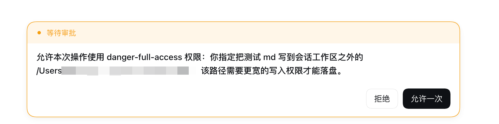
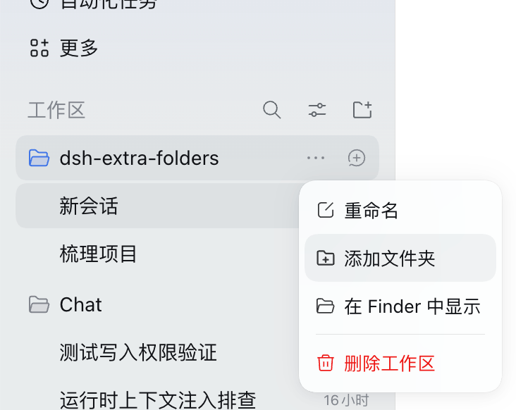
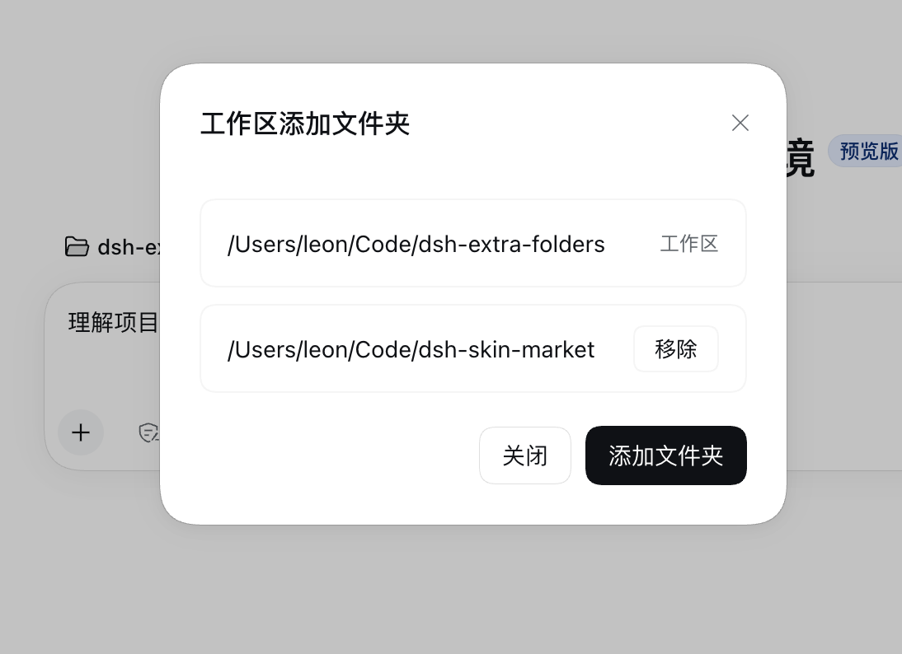

# dsh-extra-folders

When a project spans several folders, or you temporarily need to write outside the workspace, add those folders to the workspace. Sessions and subagents can then write them directly, without repeated approvals and without granting full access.

Before adding a folder, writing outside the workspace triggers an approval:



| Workspace menu | Dialog |
| --- | --- |
|  |  |

## Install and update

DSH 0.2.2-alpha.3 or later.

### Option 1: Add from the UI

**Settings → Plugins → Add plugin**

```text
dsh-extra-folders@latest
```

### Option 2: Command line

```sh
dsh plugin --profile desktop add dsh-extra-folders@latest
```

### Option 3: Ask an agent for help

<details>
<summary><strong>Expand the install prompt</strong></summary>

```text
Please install dsh-extra-folders into the current profile:
npm package dsh-extra-folders@latest (source https://github.com/kingOfSoySauce/dsh-extra-folders)

First, confirm three things in read-only mode: whether the host is Desktop or Web, the current profile name, and whether the dsh version is >= 0.2.2-alpha.3.
If the version is too low, tell me and do not try to install.

On Desktop, prefer Plugins → Add plugin and paste
dsh-extra-folders@latest
If the current host provides plugin management tools, you can also run
dsh plugin --profile <profile> add dsh-extra-folders@latest.

After install, check that the plugin row is enabled. If a restart is needed, tell me and I will restart it myself.
Do not edit the profile's package.json by hand, and do not touch other plugins.
When it is installed, take me to the more menu of a sidebar workspace row and confirm that it contains "Add folder".
```

</details>

<details>
<summary><strong>Expand the update prompt</strong></summary>

```text
Please update dsh-extra-folders to the latest version:
npm package dsh-extra-folders@latest (source https://github.com/kingOfSoySauce/dsh-extra-folders)

First, confirm four things in read-only mode: whether the host is Desktop or Web, the current profile name, the installed version, and the latest version on npm.
If it is already the latest, tell me and do not reinstall.

On Desktop, prefer Plugins → Add plugin and add
dsh-extra-folders@latest
If the current host provides plugin management tools, you can also run
dsh plugin --profile <profile> add dsh-extra-folders@latest.

After the update, check that the plugin row is enabled. If a restart is needed, tell me and I will restart it myself.
Do not edit the profile's package.json by hand, and do not touch other plugins.
When it is updated, take me to the more menu of a sidebar workspace row and confirm that "Add folder" is there and the folders I added before are still listed.
```

</details>

Whichever option you use, if the version still looks old after updating, turn the plugin row off and on in Plugins.

## Usage

Sidebar workspace row → the more button at the end of the row → **Add folder**.

The first row in the dialog is the workspace itself. It is always writable and cannot be removed. The rows below are the folders you added. You can remove each one on its own. Adding and removing take effect right away. No refresh, and no need to wait for the next session.

The grant follows the workspace. Subagents are covered too. Sessions in other workspaces do not see these folders.

## Strengths

- **Native UI**: the dialog and buttons belong to the host, opened from the workspace row menu. Colors and fonts follow the host, so appearance plugins are naturally compatible.
- **No new tools**: the model sees the same toolset as before, and prefix-cache hits are unaffected.
- **No prompt text**: the plugin writes nothing into the context. DSH's own writable-directories note is updated at the end of the session history when folders change; earlier prefixes stay put.
- **No kernel patch**: the filesystem and the sandbox are untouched. One resolve method is wrapped, and disabling the plugin restores stock behavior.
- **Scoped grant**: grants are stored per workspace; other workspaces do not see these folders. Folders can only be added or removed from the UI, and the model has no way to widen its own access.
- **Zero dependencies**: one host file, one client file, no build step, no third-party packages.

How grants work, where state lives, and what does not apply: see [Design notes](https://github.com/kingOfSoySauce/dsh-extra-folders/blob/main/DESIGN.en.md).

## Compatibility

| Environment | Status |
| --- | --- |
| macOS desktop 0.2.2-rc.1 | Verified |
| DSH 0.2.2-alpha.3 and later | Supported |
| DSH 0.2.1 and earlier | Not supported. The kernel has no `additionalWritableRoots` and no workspace menu service |
| Web (`dsh web`) | Same code as desktop. The folder picker is replaced by in-app browsing. Not tested |
| Windows | Applies to the file tools only. The sandboxed shell is not affected. This limit comes from DSH. Not tested |

The kernel is checked when the host starts. If the kernel is not supported, the plugin writes one clear log line and stops.

## Uninstall

```sh
dsh plugin --profile desktop remove dsh-extra-folders
```

You can also remove it directly in Plugins.

## Troubleshooting

| Symptom | What to do |
| --- | --- |
| No "Add folder" in the menu | Check that the plugin row is on and refresh the page once. dsh below 0.2.2-alpha.3 does not have this item |
| I added a folder but it still asks for approval | Check whether the session permission is `read-only`. Attached folders do not apply in that mode |
| An old session still asks for approval, or asks first whether to request it | Start a new session. The approval habit from earlier turns carries over. A new grant does not rewrite the pattern already set in that conversation |
| I picked a folder but it was not added | The plugin only accepts real directories. A symlink is rejected, so pick the path it points to |
| bash cannot write on Windows | DSH only grants attached folders to the file tools. This is a DSH limit and the plugin cannot change it |
| On Web, the dialog opens but there is no system picker | On Web, in-app browsing replaces the system dialog |

## License

MIT
