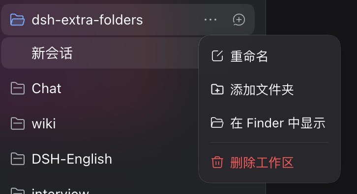
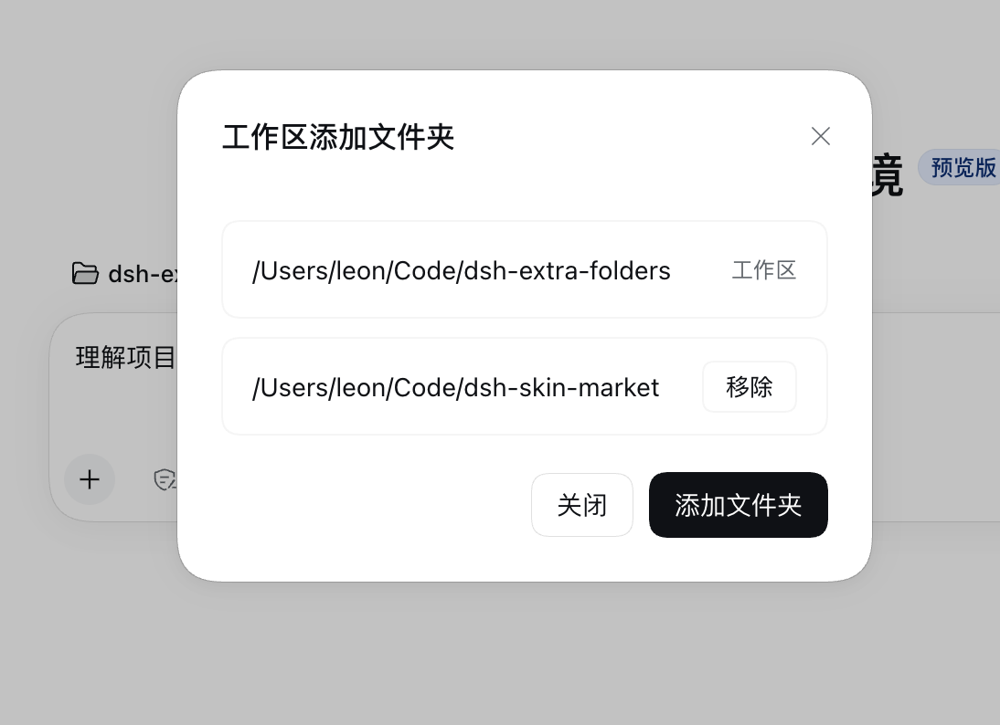

# dsh-extra-folders

给一个工作区多挂几个可写文件夹。装好以后，侧栏工作区行的菜单里多一项「添加文件夹」，选进来的文件夹对这个工作区的会话可写，文件工具和 shell 都认，写到那里不用再逐次点授权。

| 工作区菜单 | 对话框 |
| --- | --- |
|  |  |

## 安装

需要 DSH 0.2.2-alpha.3 及以上。

### 方式一：命令行

从 GitHub 安装：

```sh
dsh plugin --profile desktop add github:kingOfSoySauce/dsh-extra-folders
```

用本地目录：

```sh
dsh plugin --profile desktop add link:/绝对路径/dsh-extra-folders
```

桌面端也可以在 **设置 → Plugins → Add plugin** 里选中本仓库目录。装完确认插件行是开着的。

### 方式二：让 Agent 装

<details>
<summary><strong>点击展开提示词</strong></summary>

```text
请帮我把 dsh-extra-folders 装到当前 profile：
https://github.com/kingOfSoySauce/dsh-extra-folders

先只读确认三件事：宿主是桌面端还是 Web、当前 profile 名、dsh 版本是否 >= 0.2.2-alpha.3。
版本不够就直接告诉我，不要尝试安装。

桌面端优先用 Plugins → Add plugin 选本仓库目录；如果当前宿主提供了插件管理工具，也可以执行
dsh plugin --profile <profile> add github:kingOfSoySauce/dsh-extra-folders。

装完核对插件行是启用状态。需要重启时告诉我，由我自己重启。
不要手改 profile 的 package.json，不要动其他插件。
装好后带我到侧栏工作区行的更多菜单，确认里面有「添加文件夹」。
```

</details>

## 使用

侧栏工作区行 → 行尾的更多按钮 → **添加文件夹**。

弹框第一行是工作区本身，它一直可写，不能移除。下面是你添加的文件夹，可以单独移除。添加和移除都立即生效，不用刷新，也不用等下一个会话。

授权跟着工作区走。子 agent 也算在内，其他工作区的会话看不到这些文件夹。

## 它为什么这样写

- **简洁**：宿主和客户端各一个文件，没有 npm 依赖，没有构建步骤。
- **原生**：弹框用 DSH 官方的 `Modal` 和 `Button`，外观、焦点和 Esc 行为跟随宿主主题。
- **稳定**：不替换文件系统和沙箱实现，只在策略解析这一层加东西。关掉插件就回到原生行为。
- **副作用小**：不写 profile 的全局配置，不动其他插件，不碰 `AGENTS.md`。
- **不污染上下文**：不注册任何模型工具。只有可写目录列表变化时，DSH 自己渲染的那一行才会更新，列表没变不重复追加。
- **不额外要权限**：只有你手动添加的文件夹生效，模型没有加目录的能力。

## 兼容性

| 环境 | 状态 |
| --- | --- |
| macOS 桌面端 0.2.2-rc.1 | 已验证 |
| DSH 0.2.2-alpha.3 及以上 | 支持 |
| DSH 0.2.1 及更早 | 不支持。内核没有 `additionalWritableRoots`，也没有工作区菜单服务 |
| Web（`dsh web`） | 代码与桌面端相同，文件夹选择器换成应用内浏览。未实测 |
| Windows | 只对文件工具生效，沙箱里的 shell 不受影响。这条限制来自 DSH 本身，未实测 |

宿主启动时会检查内核。不支持就写一条明确日志并退出，不会留下一个点了没反应的菜单。

## 更新与卸载

更新：拉最新代码，然后在 Plugins 里把插件行关掉再打开。

```sh
cd /绝对路径/dsh-extra-folders && git pull
```

卸载：

```sh
dsh plugin --profile desktop remove dsh-extra-folders
```

也可以在 Plugins 里直接移除。

## 遇到问题

| 现象 | 处理 |
| --- | --- |
| 菜单里没有「添加文件夹」 | 确认插件行开着，刷新一次页面；dsh 低于 0.2.2-alpha.3 不会有这一项 |
| 加了文件夹还是弹授权 | 看会话权限是不是 `read-only`，这个模式下附加文件夹不生效 |
| 选了文件夹却没加上 | 插件只收真实目录，选了软链接会被拒绝，选它指向的路径 |
| Windows 上 bash 写不进去 | DSH 只给文件工具放行附加目录，这是 DSH 的限制，插件改不了 |
| Web 端点开但没有系统选择器 | Web 端由应用内浏览代替系统对话框 |

## License

MIT
