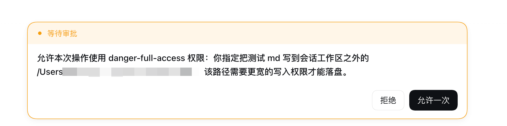

# DSH工作区添加文件夹插件

项目跨了几个文件夹，或者临时要访问工作区外的文件时，把文件夹加进工作区。之后工作区里的会话和子 agent 都能直接写，不用再逐次点授权，也不用放开全部权限。

加文件夹之前，写工作区外的文件会触发审批：



| 工作区菜单 | 对话框 |
| --- | --- |
|  |  |

## 安装、更新

DSH 0.2.2-alpha.3 及以上。

### 方式一：界面添加

**插件 → 添加插件**

```text
dsh-extra-folders@latest
```

### 方式二：命令行

```sh
dsh plugin --profile desktop add dsh-extra-folders@latest
```

### 方式三：Agent 帮忙

<details>
<summary><strong>展开安装提示词</strong></summary>

```text
请帮我把 dsh-extra-folders 装到当前 profile：
npm 包 dsh-extra-folders@latest（源码 https://github.com/kingOfSoySauce/dsh-extra-folders）

先只读确认三件事：宿主是桌面端还是 Web、当前 profile 名、dsh 版本是否 >= 0.2.2-alpha.3。
版本不够就直接告诉我，不要尝试安装。

桌面端优先用 Plugins → Add plugin，粘贴
dsh-extra-folders@latest
如果当前宿主提供了插件管理工具，也可以执行
dsh plugin --profile <profile> add dsh-extra-folders@latest。

装完核对插件行是启用状态。需要重启时告诉我，由我自己重启。
不要手改 profile 的 package.json，不要动其他插件。
装好后带我到侧栏工作区行的更多菜单，确认里面有「添加文件夹」。
```

</details>

<details>
<summary><strong>展开更新提示词</strong></summary>

```text
请帮我把 dsh-extra-folders 更新到最新版：
npm 包 dsh-extra-folders@latest（源码 https://github.com/kingOfSoySauce/dsh-extra-folders）

先只读确认四件事：宿主是桌面端还是 Web、当前 profile 名、已装版本、npm 上的最新版本。
已经是最新就直接告诉我，不要重装。

桌面端优先用 Plugins → Add plugin 重新添加
dsh-extra-folders@latest
如果当前宿主提供了插件管理工具，也可以执行
dsh plugin --profile <profile> add dsh-extra-folders@latest。

更新完核对插件行是启用状态。需要重启时告诉我，由我自己重启。
不要手改 profile 的 package.json，不要动其他插件。
更新后带我到侧栏工作区行的更多菜单，确认「添加文件夹」还在，之前加的文件夹也还在。
```

</details>

不管用哪种方式，更新后如果版本号没变，在 Plugins 里把插件行关掉再打开。

## 使用

侧栏工作区行 → 行尾的更多按钮 → **添加文件夹**。

弹框第一行是工作区本身，它一直可写，不能移除。下面是你添加的文件夹，可以单独移除。添加和移除都立即生效，不用刷新，也不用等下一个会话。

授权跟着工作区走。子 agent 也算在内，其他工作区的会话看不到这些文件夹。

## 优点

- **原生界面**：弹框和按钮都是官方的，入口在工作区行的更多菜单里。颜色、字体这些全跟宿主走，天然兼容各种外观插件。
- **不加工具**：模型看到的工具和没装时一样，不影响前缀缓存命中。
- **零提示词**：插件不往上下文里写东西。提示词和工具说明都没有，连进度提示也不写。DSH 自己的策略说明会跟着目录更新末尾那一条，前面的前缀不动。
- **不换内核**：没换文件系统，也没换沙箱。只包了权限解析那一个方法，插件一关就回到原生行为。
- **范围可控**：授权按工作区存，别的工作区看不到；加和删只能从界面点，模型没有扩权入口。
- **零依赖**：宿主一个文件，界面一个文件，不用构建，也没有第三方包。

怎么授权、状态放哪，见 [设计说明](https://github.com/kingOfSoySauce/dsh-extra-folders/blob/main/DESIGN.md)。不适用的场景也写在那里。

## 兼容性

| 环境 | 状态 |
| --- | --- |
| macOS 桌面端 0.2.2-rc.1 | 已验证 |
| DSH 0.2.2-alpha.3 及以上 | 支持 |
| DSH 0.2.1 及更早 | 不支持。内核没有 `additionalWritableRoots`，也没有工作区菜单服务 |
| Web（`dsh web`） | 代码与桌面端相同，文件夹选择器换成应用内浏览。未实测 |
| Windows | 只对文件工具生效，沙箱里的 shell 不受影响。这条限制来自 DSH 本身，未实测 |

宿主启动时会检查内核。不支持就写一条明确日志并退出。

## 卸载

```sh
dsh plugin --profile desktop remove dsh-extra-folders
```

也可以在 Plugins 里直接移除。

## 遇到问题

| 现象 | 处理 |
| --- | --- |
| 菜单里没有「添加文件夹」 | 确认插件行开着，刷新一次页面；dsh 低于 0.2.2-alpha.3 不会有这一项 |
| 加了文件夹还是弹授权 | 看会话权限是不是 `read-only`，这个模式下附加文件夹不生效 |
| 老会话还在弹授权，或者先问一句要不要申请 | 新开一个会话。之前几轮的审批习惯会延续下来，新加的授权不会改写已经形成的对话惯性 |
| 选了文件夹却没加上 | 插件只收真实目录，选了软链接会被拒绝，选它指向的路径 |
| Windows 上 bash 写不进去 | DSH 只给文件工具放行附加目录，这是 DSH 的限制，插件改不了 |
| Web 端点开但没有系统选择器 | Web 端由应用内浏览代替系统对话框 |

## License

MIT
